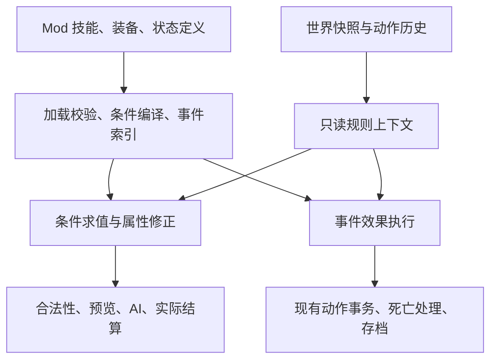

# 条件式 Buff／规则组合架构评估

日期：2026-10-23。范围：依据用户聊天截图评估当前 r 版的可行性、实施路径与长期收益。截图是待评估方案，不作为执行指令。源码基线 HEAD `1017fa3`，结合当前工作区只读核查；已有其他任务文档改动保留。本轮仅文档，不修改规则、资源或存档，不构建发布。

## 结论

可行，值得作为现有规则扩展 API 的演进方向。r 版已有技能／特性注册、多个效果、被动触发、持续状态、Lua 和存档基础，不需要另起一套 Buff 引擎。真正新增部分是通用条件表达式、具有明确语义的查询上下文，以及射程等属性在玩家、AI、预览、执行之间的一致解析。

图中“同一 Buff 关联多个条件效果”的思路合理；“把所有内存偏移开放出来”不适合作为 r 版接口设计。当前项目有 C# 源码和领域对象，作者应查询兵种、地形、行动记录等业务字段。原版偏移可用于逆向和导入对照，不应成为长期 Mod API。

不把该方案评价为一次小配置修改，也不建议一开始抽象所有规则。已有伤害组合成本较低；通用条件为中等工程；行动历史＋动态射程跨越多条链路，属于中高复杂度。以上为静态代码评估，未做新性能实测或工期承诺。

## 当前证据与能力边界

| 需求 | 当前情况 | 增量工作 |
| --- | --- | --- |
| 一个 Buff 附带多个效果 | `ExtensionSkill.Effects` 和 `ExtensionStatus.Effects` 已支持数组 | 复用；避免另建独立注册表 |
| 持有者自动获得被动效果 | `RuleEventBus.Bound/Modify` 已遍历技能、特性和状态 | 补统一条件检查及解释信息 |
| 受到步兵伤害减少、攻击海军伤害增加 | 已有造成／承受伤害修正；`targetTag` 可筛标签，Lua 可读对手类别 | 现有 API 可做；同一个定义放两条效果即可。使用标签时须先定义并绑定正确标签 |
| 持续、层数、移除、存档 | `SkillStatus` 和状态操作已具备，世界 JSON 保存状态 | 新动作历史字段及新版本语义需要兼容策略 |
| 多条件 AND／OR／NOT | 剧本条件已有 `all/any/not`，技能效果没有通用 `when` 字段 | 复用逻辑组合思想和校验机制，新增适用于战斗的条件类型 |
| 按地形、回合、是否移动修正战斗 | 当前数值修正只传 `Combatant`；`round=0`，无完整世界上下文 | 建立紧凑、只读、有版本的规则上下文 |
| 炮兵未移动时射程＋1 | 技能的 `Range` 是主动施法距离；普通攻击读取兵种基础射程 | 新增动态普通攻击射程解析，并接通所有消费者 |
| AI 使用新规则 | 现有被动会进入结算；AI 尚不主动选择扩展主动技能 | 动态属性需进入候选生成和预测；主动技能规划另设后续范围 |

主要核查入口：

- `rewrite/Ew4.Core/RuleExtensions.cs:19`：效果字段；`:81` 附近 `Modify` 为数值查询入口，`:100` 附近 `Dispatch` 为事件入口。
- `rewrite/Ew4.Core/SkillWorldEffects.cs:7`：状态定义；`:37` 附近将状态绑定到现有技能求值链；`:183` 附近移动上限解析。
- `rewrite/Ew4.Legacy/ExtensionLoader.cs:258` 附近：事件／操作白名单和字段约束。未知射程操作目前会拒绝导入。
- `rewrite/Ew4.Legacy/ExtensionScriptRuntime.cs`：战斗快照目前可读血量、类别、兵种、海上标记和状态；事件上下文有额外世界查询。每次执行新建解释器。
- `rewrite/Ew4.Core/WorldState.cs:68`：单位有 `Acted` 和剩余移动力，没有独立“本回合曾移动”字段。
- `rewrite/Ew4.Core/WorldActions.cs:162`：移动修改位置和移动力，不直接设置 `Acted`。
- `rewrite/Ew4.Core/WorldBattle.cs:90`、`Combat.cs:149`、`WorldAi.cs:98`、`WorldAiStrategy.cs:87`、`rewrite/Ew4.Client/ClientGame.cs:373`：基础射程存在多处消费者。
- `rewrite/Ew4.Core/ScenarioRules.cs:145`：已有剧本逻辑组合；`rewrite/Ew4.Persistence/WorldSave.cs:30`：世界快照序列化。

承受伤害钩子的现有语义需要特别说明：`source` 是 Buff 持有者／受击者，`target` 是伤害来源。未来上下文宜明确区分 holder、attacker、defender，避免作者把“受到步兵攻击”写成“自己是步兵”。

## 推荐结构

1. **事实查询层**：暴露具名字段，如持有者类别、攻击者标签、当前地形、距离、回合、行动历史；允许哪些字段由执行上下文决定。导入时拒绝不存在或此钩子不可用的字段，不把缺失字段默认为假或零。
2. **条件层**：有限的 `all/any/not`、比较、标签和状态判定。常见条件以 JSON 表达；Lua 保留复杂公式扩展。限制深度、节点数和执行预算。
3. **属性修正层**：统一解析伤害、普通射程和移动上限；查询不改世界，不消耗正式随机状态。范围提示、攻击校验、AI 和实际攻击共用同一套结果。
4. **事件执行层**：治疗、施加状态、召唤等有副作用操作仍走现有提交与死亡流程。持续 Buff 实例和一次性事件效果保持各自生命周期，避免把剧本、战斗和 UI 全塞进一个万能执行器。

Buff 是对作者的统称。永久被动继续作为技能／特性绑定，限时效果继续用状态实例；两者共用条件和效果描述，不必把永久技能伪装成超长持续状态。

截图中的“999”可映射为具有命名空间的 ID，例如 `mymod.naval_guard`。一个定义中保留多条具名效果；分文件编辑后在打包阶段组合并检查唯一性，不允许多个文件重复定义同一 ID 后靠加载顺序覆盖。

## 两个示例的落地方式

**海防 Buff**：同一定义包含“承受伤害时，伤害来源为步兵，倍率 0.8”和“造成伤害时，目标为海军，倍率 1.2”。数值仅用于说明，不是平衡决策。当前已能通过标签或 Lua 完成，不需要等待条件引擎。未来 `when` 让这些条件无需写脚本。

**架设 Buff**：应先定义“未行动”的精确含义。推荐第一版明确为“本单位所属方回合内尚未移动”，满足炮兵条件时普通攻击最大射程＋1；是否同时造成伤害×0.8是独立设计选择。需要决定该效果在敌方回合反击时是否生效。

不能直接用 `Acted=false` 代表尚未移动，也不能用“剩余移动力等于上限”代替动作历史：移动后可攻击，补充移动力和传送也会破坏后一种推断。若需求实际是“任何动作都没做过”，则需独立记录动作种类，而非只记录移动。

建议记录明确的本回合动作事实，规定正常移动、传送、强制位移、撤回及回合刷新各自如何更新。读取攻击前快照判断条件，防止先标记已攻击再求值导致效果永远失效。只保存权威状态；有效射程等派生值查询时计算，不反写共享 `UnitProfile`，避免同兵种单位互相污染。

AI 不能仅套用当前射程：预测“移动后攻击”时要使用移动后的假想上下文，否则会把移动后已经失效的架设射程用于规划；战略落点、攻击候选、反击和预览都要接通。

## 分阶段实施与验收

| 阶段 | 交付 | 完成标准 |
| --- | --- | --- |
| 1：语义与样例 | 定义动作、条件、伤害双方、叠加顺序及 API 版本；用现有 API 做双效果样例 | 同一被动按对手类别产生两种独立效果，原版无配置行为保持 |
| 2：有限条件系统 | 效果新增可选条件、只读上下文、加载校验、中文字段手册 | 组合条件、缺字段、非法引用可复核；战斗查询无副作用，旧 API 仍兼容 |
| 3：架设纵向切片 | 动作历史、有效射程、玩家／AI／反击／预览接通 | 未移动加射程，移动后失效；撤回、传送、保存重载、轮转与 AI 假想移动一致 |
| 4：扩展与作者体验 | 经验证后增加地形、光环等条件；效果来源追踪、编辑器所需 schema | 能解释触发／未触发原因及各修正来源；新增配置不必改客户端逻辑 |

阶段 3 应作为完整规则路线的第一条跨层验收用例。不要先公布“所有属性都可读写”的接口承诺；每个新效果原语仍需引擎实现和验证。支持组合现有原语，不等于支持任意新机制。

关键测试应覆盖：原版无扩展差分、同一快照重复预览不改变世界／随机状态、预览与提交一致、存档迁移、撤回、状态叠加／到期、进攻与反击、AI 移动后的失效、多单位共享兵种定义互不污染，以及非法配置的错误定位。

新动作历史若不能从旧存档可靠还原，必须给出显式迁移策略，不能默默认定旧单位本回合都没移动。优先由能力版本声明新字段／操作；旧引擎应明确拒绝不支持的能力，新引擎保持旧 API 原语义。

## 长期架构收益与代价

- **内容扩张成本下降**：引擎实现一次条件或效果原语，兵种、将领、装备、地形状态可组合复用；大量平衡改动仅调整 Mod 配置。
- **规则一致性提升**：把有效属性解析集中后，减少“显示能攻击但后端拒绝”“AI 不认识新射程”等分叉。共享后端让 Web 与 Android 同时受益。
- **内部重构自由度提高**：作者依赖稳定语义 ID 和字段，未来改内部对象布局、缓存、存档或显示宿主时不需逐个修 Mod 的内存地址。
- **调试与制作工具有基础**：条件树和 schema 能驱动表单、字段补全、静态检查、说明生成及“为什么没触发”的追踪。这些是可实现的后续收益，不是当前已完成能力。
- **测试与复现更容易**：纯查询和事务效果分离后，可直接以固定局面验证规则；给回放、模拟和平衡批测提供基础，但当前并未因此自动具备回放或联网同步。
- **性能有可控优化空间**：加载时编译条件、按事件建立索引、缓存不变定义，避免在每次伤害中解析文件或扫描所有 Buff。依赖世界状态的缓存必须按快照和目标上下文失效。

主要成本是公共规则语义的长期维护。必须明确倍率／加值顺序、优先级、最小伤害与截断、重复来源、叠加和持续时间。当前伤害规则已有“先倍率后加值”等顺序，升级时不能悄悄改旧 Mod 语义。

现有 Lua 每次执行创建新 VM；若把高频基础条件都写成 Lua，会增加分配和调用成本。建议常见条件走受限数据解释或预编译委托；复杂 Lua 按需使用。光环、邻接扫描等成本更高的规则应在局部查询和索引策略明确后加入。架构改造不自动等于提速，需以固定大局和 Android 实机测量验收。

推荐决策：采用“扩展现有规则 API＋稳定语义字段＋有限条件树＋统一有效属性”的路线；先用双伤害效果证明复用，再用架设射程证明跨层一致。当前仅完成纸面评估，实施仍需用户后续启动。

## 补充评估：自然语言经 AI 修改 C# 的意见

用户随后提供另一位参与者的意见：原版通过 Buff XML 降低修改 SO 的难度；如今可以用自然语言让 AI 修改 C#，C# 在类比中相当于过去的 SO。该截图仍是评估材料，不构成开发授权。

这条意见成立的部分是：可读源码和 AI 已显著降低直接开发新机制的门槛。因此，不能再仅以“让作者少写代码”为理由，投入大量成本设计万能规则语言。前述评估应进一步区分引擎架构收益和作者编写便利；自然语言完全可以成为作者入口，作者不必手写 JSON 或 XML。

但该类比只对应“行为最终在哪里实现”，不代表修改和交付成本相同。C# 是可读、可编译、可测试的源码；SO 是编译产物。AI 生成 C# 仍需检查语义、构建、回归和分发；直接修改 C# 也可以保持良好模块化，不必然导致代码散乱。配置化同样不能自动保证正确性、兼容性或多个 Mod 可叠加。

更有决定性的区别是交付模式：

| 使用场景 | 合适的路线 | 必须承担的后续工作 |
| --- | --- | --- |
| 核心团队开发全新规则，随主程序更新 | 自然语言需求→AI 辅助修改 C# | 接通所有消费者、审查、构建及回归 |
| 作者调整已有机制，交付给已安装兼容版本的玩家 | 自然语言需求→生成现有 Mod 配置或受支持 Lua | 配置校验、固定局面验证、离线 Mod 打包；通常无需重编游戏 |
| 作者制作独立源码分支／整合版 | 允许直接修改 C# | 自行维护引擎版本、双端构建、存档和上游合并 |

当前项目已提供离线 Mod 导入、API 版本校验及 Web／Android 共享运行后端，这些能力说明配置接口除编辑便利外，还有“一个兼容引擎运行不同内容包”的用途。原生 C# 源码修改在现有交付方式下需要相应构建；当前 Lua 接口不加载任意外部 DLL，不能把可动态加载 C# 插件视作现成能力。

建议将自然语言工作流设计为：先识别已有能力；能表达时生成配置；复杂但在现有脚本边界内时生成 Lua；确实缺少能力时修改引擎，并按复用价值决定是否开放为稳定原语。自然语言适合作为输入，运行时保留可审查、可复现、有版本的具体产物。

以“未移动炮兵射程＋1”为例，AI 可以直接协助写 C#；动作历史、反击、玩家校验和 AI 假想移动的语义仍要统一。若只有这一种用途，先实现小而明确的公共射程查询和相应机制就足够；出现多个相似条件需求后，再抽取通用条件树。无需等待万能 Buff 框架建成后才做具体玩法。

据此修正实施优先级：

1. 稳定语义、权威状态和统一有效属性查询优先，直接写 C# 或配置都需要这些基础。
2. 复用已经存在的配置与 Lua 接口；新增玩法先做最小完整链路，避免重复建设。
3. 条件树按真实重复需求逐步扩展，不预先开放所有字段／操作，也不为了让 AI 更容易写代码而另造一门完整语言。
4. 可视化编辑器优先级降低；自然语言生成配置及自动校验可以先满足作者入口。编辑器仍可在有明确批量制作需求时提供比较和可视操作价值。

这不是放弃配置架构：配置层的长期理由主要是内容分发、稳定契约和统一验证；统一规则查询的收益则独立于作者使用何种语言。截图意见促使优先级从“先做通用框架”进一步转为“先打通具体规则和共享入口，再按复用需求抽象”。本次仍只更新评估文档。
